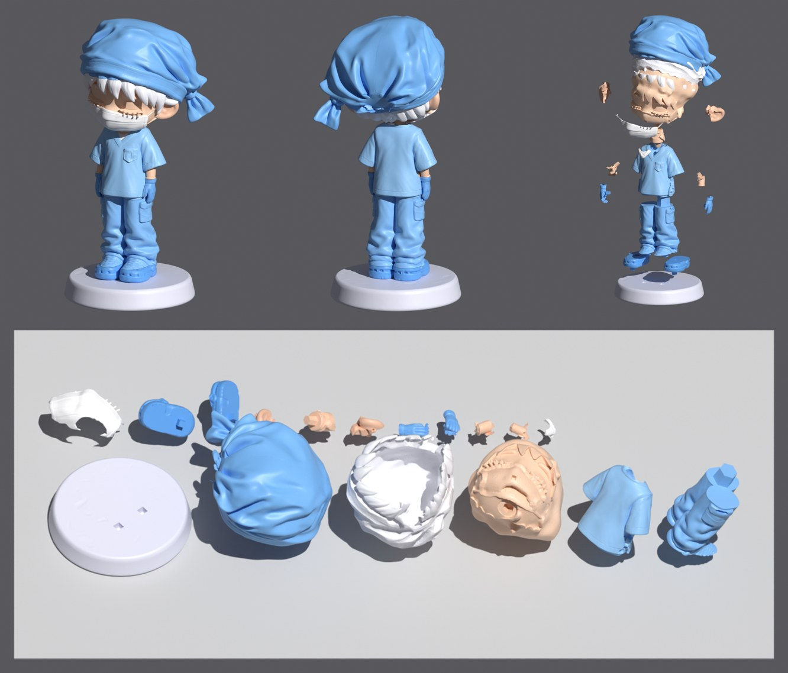

# Фигурка «Хирург» — набор деталей для печати смолой

Высота в сборе: 90 мм (вместе с подставкой). 17 деталей, все замкнутые (watertight), каждая — одна цельная часть.

## Файлы

| Файл | Что это |
|---|---|
| `parts/*.stl` | Каждая деталь отдельно, в положении «как в собранной фигурке» (мм) |
| `plate.3mf` | Все детали, разложенные на одну платформу 218×123 мм, уже наклонены; каждая деталь — отдельный объект |
| `layout.json` | Размеры и высоты деталей на платформе |
| `parts_summary.json` | Объёмы деталей и список всех соединений |
| `preview/` | Рендеры: сборка, разборка, платформа, исходные виды |

## Детали

| Деталь | Файл | Объём, мм³ | Размер, мм |
|---|---|---|---|
| Подставка | base | 8524 | 41×41×7 |
| Крокс правый / левый | croc_R / croc_L | 481 / 483 | 9×17×6 |
| Штаны | pants | 3201 | 19×16×28 |
| Рубашка | shirt | 3322 | 26×15×24 |
| Футболка (вставка в вырез) | tshirt | 12 | 7×3×4 |
| Шея | neck | 176 | 8×6×12 |
| Рука правая / левая | arm_R / arm_L | 37 / 32 | 5×5×7 |
| Перчатка правая / левая | glove_R / glove_L | 46 / 41 | 5×5×8 |
| Голова | head | 12148 | 29×29×32 |
| Ухо правое / левое | ear_R / ear_L | 106 / 113 | 7×9×9 |
| Волосы | hair | 2802 | 34×32×33 |
| Шапочка | cap | 4190 | 39×37×35 |
| Маска | mask | 195 | 23×10×9 |

«Правый/левый» — со стороны самой фигурки.

## Соединения

Ключи квадратные или шестигранные, слегка сужаются к концу (как в наборах Bulkamancer): деталь встаёт
только в одном положении и сама центрируется. Зазор в гнезде 0,10 мм на сторону, по дну 0,25 мм.
Между деталями по стыкам зазор ≈0,09 мм.

| Стык | Соединение |
|---|---|
| кроксы → подставка | квадратный ключ 2,2 мм, глубина 2 мм |
| штаны → кроксы | квадратный ключ 2,6 мм, глубина 2,2 мм |
| штаны → рубашка | шестигранный вкладыш 6 мм, глубина 4,2 мм |
| шея → рубашка, шея → голова | шестигранные ключи 3 мм, глубина 2,5 и 3 мм |
| руки → рубашка (в рукав) | квадратный ключ 1,4 мм, глубина 2 мм |
| перчатки → рубашка (кисть на бедре) | квадратный ключ 1,4 мм, глубина 1,5 мм |
| перчатки ↔ руки | на клей, стыкуются по форме |
| уши → голова | квадратный ключ 1,4 мм, глубина 1,5 мм |
| маска → голова | квадратный ключ 1,2 мм, глубина 1,2 мм |
| футболка → рубашка | квадратный ключ 1 мм |
| волосы → голова | квадратный ключ 2 мм, глубина 2 мм |
| шапочка → волосы | маленький фиксатор 0,9 мм + посадка по форме |

## Порядок сборки

1. Кроксы → подставка.
2. Штаны → кроксы.
3. Рубашка → штаны (шестигранный вкладыш).
4. Футболка → в вырез рубашки.
5. Руки → в рукава, затем перчатки (ключ в бедро + клей к руке).
6. Шея → рубашка.
7. Голова → шея. Затем уши, маска.
8. Волосы → на голову, шапочка → на волосы.

Детали можно сначала примерить без клея, все стыки разборные.

## Печать

- Раскладка в `plate.3mf`: невидимые стороны деталей (места стыков) повёрнуты к платформе, поэтому
  следы поддержек останутся на скрытых поверхностях. Наклон 25°, подъём 5 мм под поддержки.
  Подставка лежит плоско.
- Поддержки поставьте в слайсере (Lychee / Chitubox, авто-поддержки, лёгкие на мелких деталях).
- Голова (12 см³) и подставка (8,5 см³) сплошные. Для экономии смолы их можно сделать полыми
  в слайсере (стенка 1,5–2 мм) с дренажным отверстием в скрытом месте: у головы — сверху под
  шапочкой, у подставки — снизу. Гнёзда ключей не перекрывайте.
- Перед печатью всего набора стоит распечатать одну пару (например, шея + голова), чтобы проверить
  посадку на вашей смоле. Если туго — увеличьте зазор (параметр `PEG_CLEAR` в `tools/build_parts.py`).

## Как это сделано

Исходная картинка → 3 сгенерированных вида (сзади и по бокам) → 3D-модель (Tripo, мультивид) →
чистая замкнутая сетка (воксельный ремеш) → убран лишний бант сзади на шапке → разметка
поверхности по деталям → нарезка объёма (шапка, волосы и маска — оболочки на гладком ядре головы,
тело режется плоскостями) → ключи и гнёзда → раскладка на платформу.
Скрипты лежат в `tools/`.
