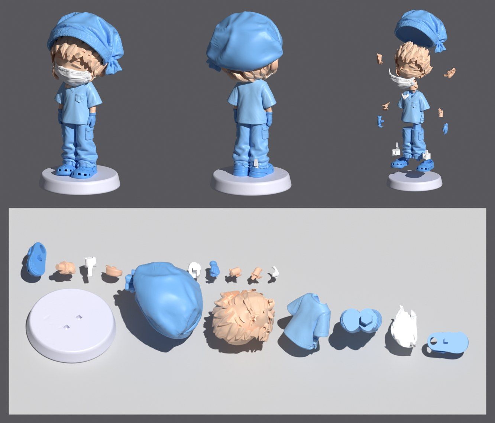
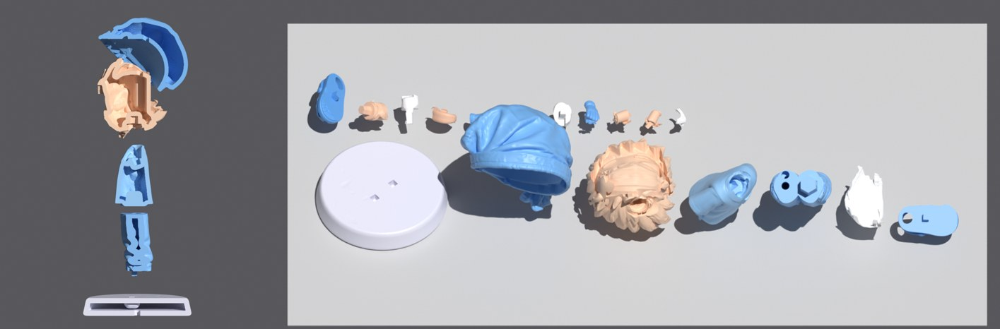

# Фигурка «Хирург» — версия 2 (детали перегенерированы)

90 мм в сборе. 18 деталей, все замкнутые, без пересечений между собой.

## Что изменилось по сравнению с v1

- **Шапочка** сгенерирована заново целой деталью: один узел справа-сзади, лишнего банта нет.
  Внутри — отпечаток макушки волос с зазором 0,1 мм; шапка надевается **сверху** и ни за что не цепляется.
- **Голова** — новая (лицо, брови, ресницы), **волосы приклеены к голове** (одна деталь): отдельный парик
  с чёлкой физически нельзя надеть на голову из твёрдой смолы — чёлка упирается в лоб.
- **Маска** — новая, с петлями; надевается **спереди**, внутри отпечаток лица.
- **Уши** — новые, вставляются в голову квадратным ключом.
- **Кроксы** — целые, отдельная обувь (ремешок, заклёпка, дырочки).
- **Носки** (короткие белые) вставляются в кроксы сверху; из носка вверх — квадратный ключ в штанину.
- **Штаны** — низ штанин обрезан по кроксам, надеваются сверху на носки и кроксы.
- Рубашка, футболка, шея, руки, перчатки — из v1.

## Сборка

1. Кроксы → подставка (квадратный ключ 2,2 мм).
2. Носки → в кроксы.
3. Штаны → на носки (ключ 2 мм из каждого носка).
4. Рубашка → штаны (шестигранный вкладыш), футболка → в вырез.
5. Руки → в рукава, перчатки → к бёдрам (ключи).
6. Шея → рубашка, голова → шея (шестигранные ключи).
7. Уши → голова, маска → лицо (спереди), шапка → на волосы (сверху).

## Файлы

- `parts/*.stl` — детали в положении «как в сборе».
- `plate.3mf` — все детали на платформе 218×123 мм, наклон 25°, подъём 5 мм под поддержки.
- `parts_summary.json` — объёмы, размеры и список ключей.
- `preview/` — рендеры и листы-раскладки, из которых генерировались детали.

## Полости и дренаж

Пять крупных деталей полые, остальные мелкие — сплошные. Полость везде одна, к ней ведут две
дренажные дырки Ø2,5 мм (смола вытекает, промывка проходит насквозь). Замкнутых пустот нет.
Стенка отсчитана от всей поверхности, включая гнёзда, поэтому вокруг каждого гнезда ≥ стенки.

| Деталь | Стенка | Было | Стало | Дырки (скрытые) |
|---|---|---|---|---|
| Шапка | 1,6 мм | 10,8 см³ | 5,9 см³ | изнутри, со стороны волос |
| Голова | 1,6 мм | 7,2 см³ | 3,7 см³ | сверху, под шапкой |
| Подставка | 2,0 мм | 8,5 см³ | 5,6 см³ | снизу |
| Рубашка | 1,6 мм | 3,3 см³ | 2,1 см³ | снизу, под штанами |
| Штаны | 1,6 мм | 3,1 см³ | 2,0 см³ | сверху, под рубашкой |

Весь набор ≈ 21 см³ смолы вместо 34. Шапка на платформе лежит открытой стороной вбок — без эффекта присоски.

## Известные ограничения

- Поддержки ставятся в слайсере (авто-поддержки). Полость в слайсере повторно не включайте.
- Перед печатью всего набора стоит распечатать пару «шапка + голова», чтобы проверить посадку на вашей смоле.
